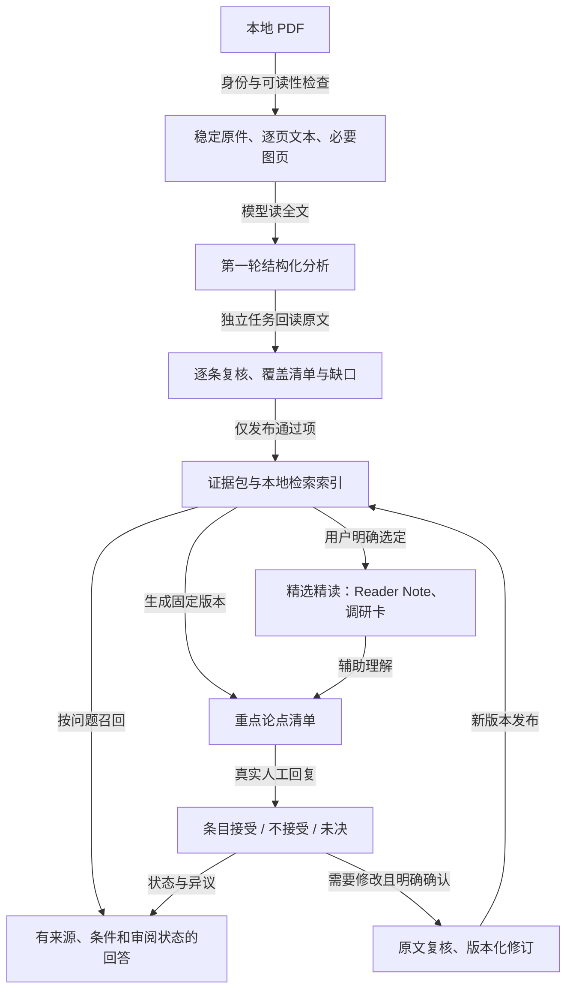

# 流程与职责

核对日期：2026-10-26。本文描述参考实现的工作方式，不携带任何现有知识库或用户授权。

## 1. 整体关系

箭头表示材料或状态流转，不表示科学因果。机器合格条目可以在人工审阅前进入日常检索；人工审阅与完整精读不是快速发布的前置条件。

## 2. 快速入库：模型与程序各做什么

| 环节 | 当前实现 | 程序不能据此证明的内容 |
| --- | --- | --- |
| 来源预检 | 确认 PDF 可读性、源 SHA-256、页数、项目 profile；缓存逐页 normal/layout 文本及必要页面渲染 | 文献身份或版本冲突仍需解决；成功提取不等于读懂 |
| 第一轮分析 | 模型读全文和随文附录，覆盖章节、实质图表、公式，提取问题、方法、结果、条件与限制；提供连续原文短段和页码 | 条目写得完整不保证无遗漏、无误解 |
| 独立第二轮 | 不继承生产者历史的任务重新读取原文、恢复覆盖清单，再逐条核对第一轮；记录真实任务身份与实际看图范围 | 任务 ID 不同本身不能证明认知独立，独立性也不消除共同模型偏差 |
| 结果校验 | 校验 schema、源/输入哈希、页号与覆盖声明、原文短段匹配、复核决策、图像检查记录的绑定 | 校验是对记录的检查，不能观察模型内部是否真的理解全部内容 |
| 发布 | 从第一轮中确定性选择第二轮通过的条目，生成稳定 chunk ID、证据包及索引；事务、恢复点、提交后回读保护一致性 | 发布成功不等于人工接受或科学结论成立 |

第二轮逐项检查：完整断言、条件与范围、数字与单位、归属、认识论层次、复合断言。通过需要各项明确支持；无法判断和需修改的内容留在缺口中。

第一轮暂存后被冻结。第二轮提出的新断言不由第二轮自己验收后直接发布；需要改写的条目也不会在发布时悄悄修复。通过项可单独发布，但必须保留覆盖缺口。源文件身份、完整性或绑定异常属于整篇阻断问题。

原文定位支持 normal/layout 提取路线。通过项的短段须在所述页按允许的空白归一化匹配；明确编号的跨页段可逐页核对，不能拼接分散文字伪造一段连续引文。字面匹配通过后，语义支持仍由实际阅读判断。

快速分支不自动生成十四模块笔记、调研卡或全文译本。相同 PDF 内容哈希可复用；相同 DOI 对应不同 PDF 时保留版本冲突，不自动当成独立证据。

## 3. 精选精读与阅读材料

用户明确选定论文后，工作单检查已有材料并复用与同一来源绑定的产物，缺少的再补齐。工作单存在不表示材料完成。

完整精读使用结构化 evidence pack 作为派生内容源，确定性生成 Reader Note、RAG 文档和调研卡等。Reader Note 的十四模块包括阅读导航、身份卡、核心工作、背景、机制、第一性原理、方法、图表、贡献、批判性审查、自测、项目迁移、组会总结和按需附录；内容应随论文类型调整，不以填满模块证明质量。

本工作流不生成全文译本。两条笔记保存在用户独立工作区；模型复核不代表人审接受。

个人理解和学习反馈不进入科学 RAG。阅读笔记不是比原文更高等级的事实源。自测和讨论只在用户要求时展开，不用考试作为人工审核的门槛。

## 4. 人工审阅与修订

**可调默认**：每篇清单通常十条，事实/数字/仪器归属等目标两条、最多三条；优先关键图解释、图文证据关系、机制推断与解释边界。只有图号的参数陈述仍是事实项。合适解释不足时少列，不用简单事实填充。

清单绑定具体条目和输入版本，显示后不重排。用户可批量接受或不接受，意见可选；未提及条目保持未审阅。记录真实回复，不把模型模拟答案当成人工判断。

| 状态 | 含义与后续处理 |
| --- | --- |
| `not_reviewed` | 当前条目未获得有效人工判断；按机器质量状态处理 |
| `faithful` | 人工认为该条目忠实于论文；不是作者机制的独立验证 |
| `needs_revision` / `unresolved` | 保留条目及意见；满足机器与来源条件时，只能带异议说明论文表述 |
| 修订后的新内容 | 原文核对、独立复核和明确修订确认后发布；不自动继承旧内容的接受 |

审阅记录与原始事件绑定失效时阻断引用。版本修订保留旧内容、意见及替代关系；未改变条目可继续使用其有效审阅。知识条目更新不表示 Reader Note 已同步更新，阅读材料受影响范围另行记录。

## 5. 检查的分工与默认参数

- **机械一致性**：身份、路径、哈希、结构、索引、提交与回读。
- **原文语义检查**：断言、条件、数值单位、归属、结论强度与定位是否受原文支持；未看或无法判断不能填通过。
- **检索验证**：查询能否找回相关内容、版本与异议能否传播、固定基准是否退化。
- **人工判断**：只记录实际发生的判断；抽检或软件测试不替代人工科学接受。

参考系统在发布后检查受影响范围，月度做机械检查、语义抽样和固定检索基准。月度样本默认 20 篇、每篇至多 3 条，分配为新增/变更 10 篇、争议 5 篇、历史轮换 5 篇，不足则如实记录实际数量与补位。此处只分享方法，不导出或创建定时任务。

其他当前默认：快速分支每篇两个逻辑模型任务（分析 `gpt-6.1-sol / medium`，复核 `gpt-6.1-sol / high`），最多三个模型子任务并发，视觉检查串行；首版快速路径对超过 40 页、扫描件或提取异常进入异常队列。模型、预算、页数限制均为环境选择，不是研究方法要求。两个逻辑任务不等于两次内部调用，成本只按可测数据报告。

## 6. 可追溯范围

当前行为核对自参考项目中的 `literature_learning.py`、`fast_pdf_intake.py`、`reading_sessions.py`、`review_checklists.py`、两个版本发布器和 `literature_cross_validation.py`，以及精读协同与快速入库协议。工作流的便携运行文件随候选提供；不包含原项目的文献库、本机配置或历史检查结果。跨机器行为及通用正确率仍须分别验证。
